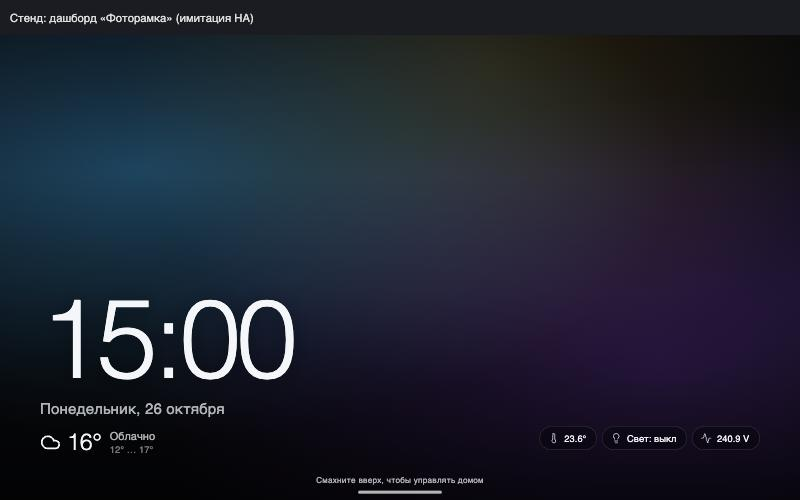
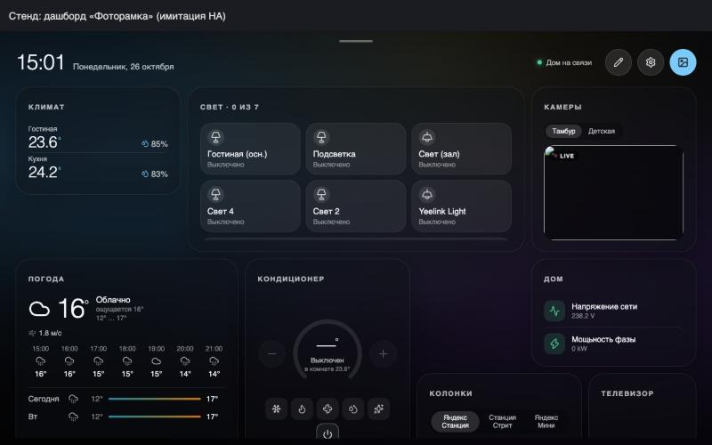
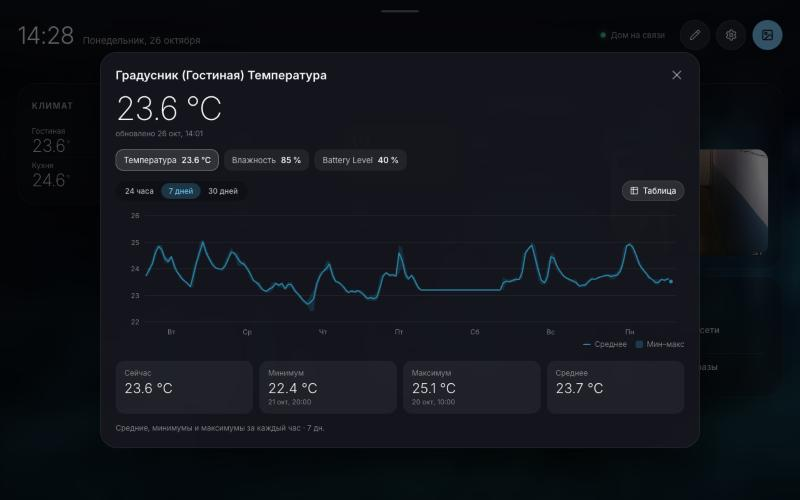
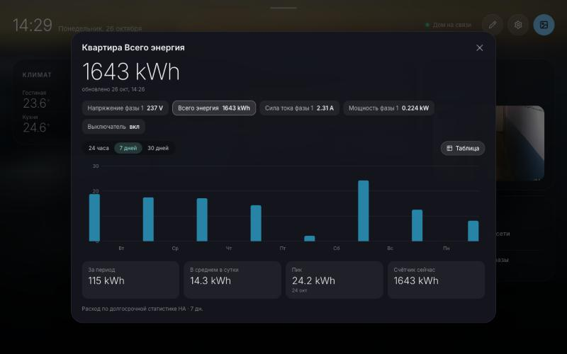

# Photo Frame for Home Assistant

**English** · [Русский](README.ru.md)

**Turn a tablet or an old phone into a photo frame that also runs your home.**
Your photos, a big clock and the weather fill the screen. Swipe up and your lights, climate,
air conditioner, cameras, speakers and TV are right there. Leave it alone for a minute — back to photos.

[](https://hacs.xyz/docs/faq/custom_repositories)
[](https://github.com/mZer0ne/lovelace-photoframe/releases)
[](LICENSE)

| Photo frame | Control panel |
|---|---|
|  |  |

| Temperature history | Energy use |
|---|---|
|  |  |

## Features

- **Photo frame.** Full-screen photos with a slow Ken Burns zoom, a big clock, the date and the weather
  from your weather integration. Small chips at the bottom: temperature, lights on, power, an open door.
  Tap a chip to get a card on top of the photo — the slideshow keeps running.
- **Swipe up for the home panel.** Like the iPhone lock screen: the background becomes a blurred copy
  of the current photo, and the accent color follows the picture.
- **Build your own cards.** A 12-column grid with square cells: drag a card to move it, pull the corner
  to resize. Card types: climate · lights & plugs · cameras · sensors · scenes · air conditioner ·
  speakers · TV · weather. Add a **whole device** — a smart breaker expands into voltage, current,
  power and energy.
- **Charts and stats.** Tap a thermometer or a sensor for its history over 24 hours, 7 or 30 days:
  min, max, average, hourly/daily consumption, how often and how long something was on.
- **Several homes.** Apartment and country house — swipe sideways. Each home is its own card layout
  built from devices in this Home Assistant (a remote house can be linked via Remote Home Assistant).
  Every device has its own *main home* it returns to.
- **The screen stays on.** Photos instead of sleep (Screen Wake Lock over HTTPS).
- **Careful by default.** Unavailable sensors are hidden; turning off a breaker takes two taps.
- **English and Russian** UI: the language follows your HA profile (or the browser) and can be
  set per device. More languages come from the community — see [CONTRIBUTING.md](CONTRIBUTING.md).

## How it works

Photo Frame is **one dashboard card** (`custom:photoframe-card`) — not an add-on, not an integration.

- **Access as the signed-in user.** The card runs inside the HA frontend and uses its connection:
  no long-lived tokens, proxies or extra servers. No URLs or tokens are stored in the card config.
- **The layout lives in the dashboard.** Cards, sizes, homes and slideshow settings are saved into
  this card's config. Every tablet and phone that opens the dashboard shows the same thing, and a change
  on one device appears on the others.
- **Only HA admins can change the layout** (saving a dashboard is an admin right).
  Other users can use the frame, they just don't get the *Customize* button.
- **Photos come from the HA media library**, folder `/media/photoframe`. Upload from the frame
  (*Settings → Photos*) or via *Media* in HA.
- **The main home is a per-device setting**, not a dashboard one: the kitchen tablet starts on
  *Apartment*, the one at the country house on *Country house*.

## Installation

1. HACS → ⋮ → **Custom repositories** → `https://github.com/mZer0ne/lovelace-photoframe`,
   category **Dashboard**.

   [](https://my.home-assistant.io/redirect/hacs_repository/?owner=mZer0ne&repository=lovelace-photoframe&category=plugin)
2. Find **Photo Frame** in HACS and install it. HACS adds the resource
   `/hacsfiles/lovelace-photoframe/dist/photoframe-card.js` (if not: *Settings → Dashboards → Resources*,
   type *JavaScript module*).
3. Create a folder for photos: `/media/photoframe` (Samba, File editor or terminal).
4. Reload the browser and open any dashboard as an admin: Photo Frame offers to
   **create a “Photo frame” dashboard** in the sidebar — one tap. Prefer doing it by hand?
   Create a dashboard → a view of type **Panel (single card)** → add the **Photo Frame** card. Or in YAML:

```yaml
views:
  - title: Photo frame
    type: panel
    cards:
      - type: custom:photoframe-card
        media_folder: photoframe
```

5. Open the dashboard on your tablet, swipe up, tap ✏️ and build your cards.

## Configuration

Everything is configured on the frame itself — no YAML needed. For reference, this is what the card config holds:

| Option | Meaning | Default |
|---|---|---|
| `media_folder` | photo folder in the HA media library | `photoframe` |
| `kiosk` | hide the HA header and sidebar (each device can override) | `false` |
| `settings.slideIntervalMs` | photo interval, ms | `10000` |
| `settings.idleSec` | seconds without touches before returning to photos (0 — never) | `45` |
| `layouts` | card layouts per home (filled in by the editor) | starter layout |
| `homes` | list of homes (filled in under *Settings → Homes*) | one home |

## Kiosk on a tablet

- Open the dashboard in the Home Assistant app or a full-screen browser.
- The frame keeps the screen on with Wake Lock (needs HTTPS). If your HA app has a *Keep screen on*
  setting, turn it on too.
- **Built-in kiosk mode** hides the HA header and sidebar while the frame is on screen and brings them
  back when you leave the dashboard. Turn it on per device (*Settings → Kiosk mode on this device*),
  for everyone with `kiosk: true` in the card config, or with `?kiosk` in the URL (`?kiosk=0` turns it off).

## Two modes: HACS card and standalone app

The same interface runs two ways. A token is needed only in the second one — and it lives only on the server.

| | HACS card | Standalone app (PWA) |
|---|---|---|
| Runs in | an HA dashboard / the HA app | a browser, *Add to Home Screen*, old Android frames |
| You install | just this card via HACS | a small Node.js service (SQLite) next to HA |
| Access to HA | as the signed-in user | the service talks to HA |
| Token | **not needed** | long-lived token **on the server only**, devices never see it |
| Layout | in the dashboard config | in the service database (SQLite) |
| Photos | HA media library (`/media/photoframe`) | the service's shared album |
| Homes | layouts of one HA | a home can have its own HA |

The standalone mode is for devices that can't open HA (an old Android 5 frame) or homes on different
HA servers. How to run the service: [docs/DEVELOPMENT.md](docs/DEVELOPMENT.md).

## Development

```bash
npm install
npm run dev            # PWA + service
npm run build:card     # dist/photoframe-card.js — the file HACS installs
```

`card-harness.html` emulates a dashboard for testing the card (live data from your HA through the
service, read-only); `card-harness.html?hadom` also mimics the HA frontend DOM for kiosk mode.

**Deploy to your own server** — `cp deploy.env.example .deploy.env`, fill it in, then:
`./deploy.sh card` puts a fresh build into your HA (same place HACS does — handy before a release),
`./deploy.sh service` updates the standalone PWA + service (systemd unit: `docs/photoframe.service`).

**Release** — `scripts/release.sh 0.2.0`: bumps the version, rebuilds `dist/photoframe-card.js`,
tags, pushes and creates a GitHub Release; the workflow attaches the built card to it.
HACS shows the latest release as the available version.

## License

[MIT](LICENSE)
